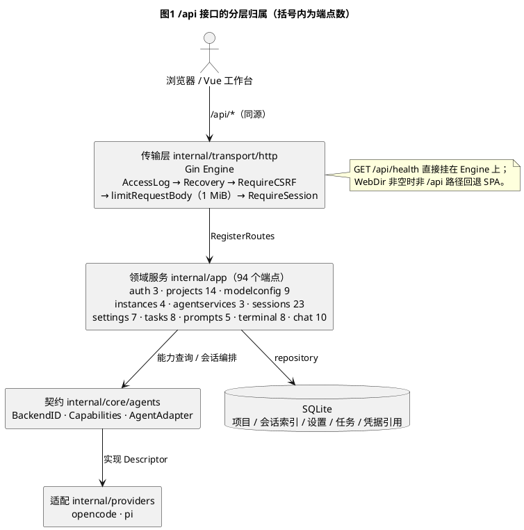
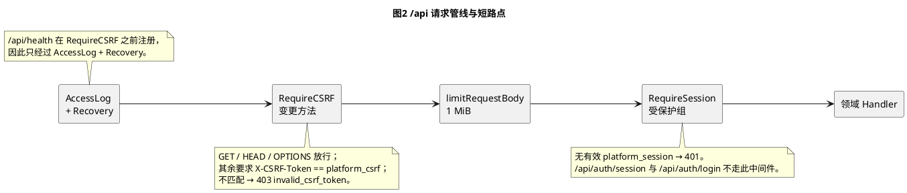
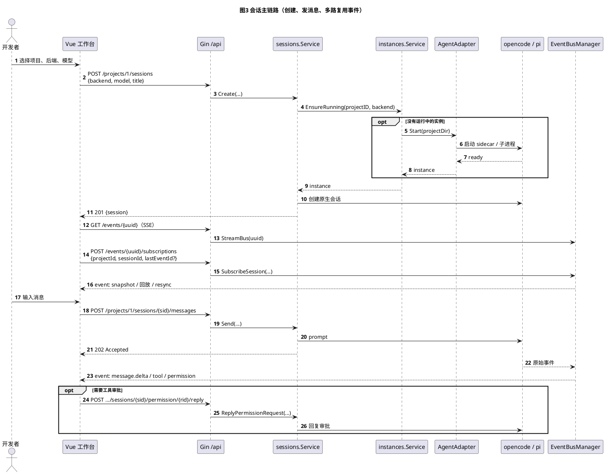
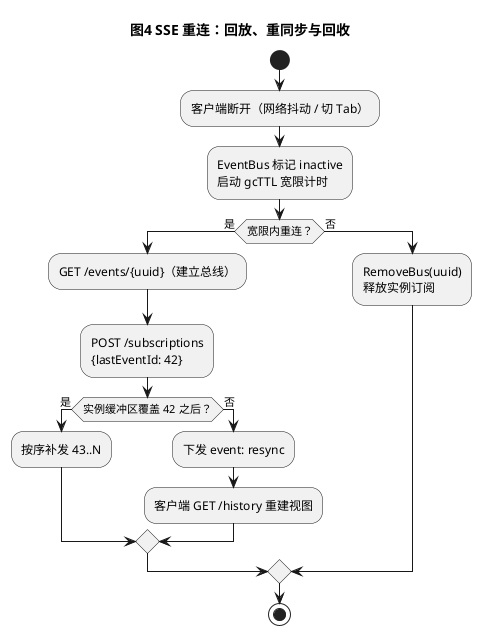
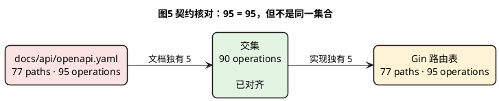

# 平台后端接口清单与分析

> 生成日期：2026-10-21
> 范围：`cmd/platform` 组合根 + `internal/transport/http` 路由 + `internal/app/*` 领域服务
> 口径：只统计 Gin 注册的 API 路由，不统计 SPA 静态兜底（`/*filepath`）与 `/assets/*`；表中路径省略统一的 `/api` 前缀
> 数据来源：路由注册点静态扫描（`RegisterRoutes` / `RegisterInteractionRoutes`）与 `docs/api/openapi.yaml` 逐项比对

## 1. 总览

| 指标 | 数值 | 说明 |
|---|---:|---|
| API 端点（operation） | **95** | 不含 SPA 静态路由 |
| 唯一路径（path） | **77** | 多个方法共享同一路径 |
| 一级分组 | **10** | 基础认证、项目、模型、Agent、会话、设置、任务、提示词、终端、纯 Chat |
| HTTP 方法 | GET 41 / POST 35 / PUT 11 / DELETE 8 | 无 PATCH |
| 协议形态 | JSON 90 / 文件流 1 / SSE 4 / WebSocket 1 | |
| 公开端点 | 2 | `GET /health`、`GET /auth/session` |
| 仅 CSRF、不需会话 | 1 | `POST /auth/login` |
| 需要会话 | 92 | 其中 51 个变更方法还需 CSRF |
| OpenAPI 覆盖 | 77 paths / 95 operations | 数量与实现相等，但集合仍有 5 换 5 偏差（见第 6 节） |

几个值得先说的结论：

1. **接口面集中在一个同源 `/api` 下**，没有版本前缀；单用户局域网部署下这是合理取舍，但契约变更没有并行版本可用。
2. **鉴权是"全局 CSRF + 分组会话"两层**：变更方法统一过双提交 CSRF，管理路由统一过会话校验，新增路由很难漏掉鉴权。
3. **85 = 85 是巧合，不是一致**：OpenAPI 与 Gin 的方法数恰好相等，但文档多出 5 个未实现的任务端点，实现多出 5 个未文档化的提示词端点（第 6 节）。
4. **会话域是绝对核心**：23 个端点（24%）围绕会话、事件流与工具审批；纯 Chat 另有一套独立的 SSE 快照流，不依赖 agent 能力门控。

## 2. 接口如何被组织

路由不是散落在 `main.go`，而是由每个领域服务导出 `RegisterRoutes`，组合根通过 `Dependencies` 显式注入；`Dependencies` 中某个服务为 `nil` 时，该组路由整体不注册（测试常用）。生产装配在 `cmd/platform/main.go` 中把 10 个服务全部注入。



**读图要点**

- 95 个端点中 94 个由 11 个领域服务注册；`health` 是唯一直接挂在 Engine 上的路由。
- `sessions` 的 23 个端点包含 `agent-backends` 目录（2 个）与 `opencode` 交互（5 个），因此它同时依赖 `core/agents` 契约与 SQLite 索引。
- `terminal` 的 WebSocket 不走 `core/agents`，只依赖 `core/platform` 的 PTY/SSH 能力。

## 3. 鉴权与请求管线

`NewRouter` 的中间件顺序是：`AccessLog → Recovery → RequireCSRF → limitRequestBody(/api 组) → RequireSession(受保护组) → Handler`。`/api/health` 在 `RequireCSRF` 安装之前注册，因此不受 CSRF 与会话约束。



| 类别 | 端点 | 凭据要求 |
|---|---|---|
| 公开 | `GET /health`、`GET /auth/session` | 无（session 端点同时下发 CSRF Token） |
| 仅 CSRF | `POST /auth/login` | `X-CSRF-Token` 必须等于 `platform_csrf` Cookie |
| 会话 + CSRF | 46 个变更方法（POST/PUT/DELETE） | `platform_session` + 双提交 CSRF |
| 仅会话 | 36 个 GET | `platform_session`（SSE/WS 复用 Cookie） |

补充安全事实：

- Cookie 为 `HttpOnly` + `SameSite=Strict`，未设置 `Secure`（平台按局域网明文 HTTP 设计）。
- 登录失败按客户端 key 限流，错误响应不区分"未配置密码"与"密码错误"。
- 所有 API 请求体上限 1 MiB；SSE 处理器通过 `http.NewResponseController` 清除写超时。
- WebSocket 的 `CheckOrigin` 恒为 `true`，实际防护依赖 `SameSite=Strict` 的会话 Cookie。

## 4. 接口清单

图例：**鉴权**列中"会话"= 需要有效会话；"+CSRF"= 变更方法还需 `X-CSRF-Token`；"公开"= 无需会话。**响应**列只标注非 200 或在语义上特殊的返回。

### 4.1 基础与认证（4）

| # | 方法 | 路径 | 说明 | 鉴权 | 响应 |
|---:|---|---|---|---|---|
| 1 | GET | `/health` | 健康检查，报告进程存活 | 公开 | 200 |
| 2 | GET | `/auth/session` | 当前会话状态与 CSRF Token，总是 200 | 公开 | 200 + `no-store` |
| 3 | POST | `/auth/login` | 共享密码登录，签发会话 Cookie | 公开+CSRF | 200 / 401 / 429 |
| 4 | POST | `/auth/logout` | 注销当前会话并清 Cookie | 会话+CSRF | 200 |

### 4.2 项目与工作区（14）

| # | 方法 | 路径 | 说明 | 鉴权 | 响应 |
|---:|---|---|---|---|---|
| 5 | GET | `/projects` | 列出已登记项目 | 会话 | 200 |
| 6 | POST | `/projects` | 登记一个已存在的目录 | 会话+CSRF | 201 |
| 7 | POST | `/projects/create` | 在父目录下新建并登记项目 | 会话+CSRF | 201 |
| 8 | POST | `/projects/{id}/move` | 移动项目目录 | 会话+CSRF | 200 |
| 9 | POST | `/projects/{id}/rename` | 重命名磁盘目录（需确认名） | 会话+CSRF | 200 |
| 10 | POST | `/projects/{id}/name` | 更新显示名（旧前端兼容入口） | 会话+CSRF | 200 |
| 11 | PUT | `/projects/{id}/name` | 更新显示名（推荐入口） | 会话+CSRF | 200 |
| 12 | POST | `/projects/{id}/unregister` | 取消登记，先停实例，不动磁盘 | 会话+CSRF | 204 |
| 13 | GET | `/projects/{id}/git-info` | Git 概要（是否仓库、分支等） | 会话 | 200 |
| 14 | GET | `/projects/{id}/files` | 按关键词搜索工作区文件 | 会话 | 200 |
| 15 | GET | `/projects/{id}/files/tree` | 懒加载文件树 | 会话 | 200 |
| 16 | GET | `/projects/{id}/files/content` | 读取文本文件内容 | 会话 | 200 |
| 17 | GET | `/projects/{id}/files/raw` | 原始字节流下载文件 | 会话 | 200（流） |
| 18 | GET | `/projects/{id}/git/status` | Git 详细状态 | 会话 | 200 |

### 4.3 模型服务与模型（9）

| # | 方法 | 路径 | 说明 | 鉴权 | 响应 |
|---:|---|---|---|---|---|
| 19 | GET | `/model-services` | 列出 OpenAI 兼容模型服务 | 会话 | 200 |
| 20 | POST | `/model-services` | 新建服务（凭据进 secrets store） | 会话+CSRF | 201 |
| 21 | POST | `/model-services/fetch-models` | 按服务配置拉取模型列表 | 会话+CSRF | 200 / 502 |
| 22 | PUT | `/model-services/{id}` | 更新服务配置 | 会话+CSRF | 200 |
| 23 | DELETE | `/model-services/{id}` | 删除服务 | 会话+CSRF | 204 |
| 24 | POST | `/model-services/{id}/models` | 手工添加模型 | 会话+CSRF | 201 |
| 25 | PUT | `/models/{id}` | 更新模型 | 会话+CSRF | 200 |
| 26 | DELETE | `/models/{id}` | 删除模型 | 会话+CSRF | 204 |
| 27 | POST | `/models/test` | 测试模型连通性 | 会话+CSRF | 200 / 502 |

### 4.4 Agent 实例与机器级服务（7）

| # | 方法 | 路径 | 说明 | 鉴权 | 响应 |
|---:|---|---|---|---|---|
| 28 | GET | `/projects/{id}/instances` | 列出项目下的 Agent 实例 | 会话 | 200 |
| 29 | POST | `/projects/{id}/instances` | 启动实例（拉起子进程/sidecar） | 会话+CSRF | 201 / 502 |
| 30 | POST | `/projects/{id}/instances/{instanceId}/stop` | 停止实例 | 会话+CSRF | 200 |
| 31 | GET | `/projects/{id}/agent-backends/{backend}/models` | 后端对该项目可用的模型（`?refresh=1` 强制刷新） | 会话 | 200 / 502 |
| 32 | GET | `/agent-services/{backend}` | 探测机器级服务状态 | 会话 | 200 |
| 33 | POST | `/agent-services/{backend}/start` | 启动机器级服务 | 会话+CSRF | 200 |
| 34 | POST | `/agent-services/{backend}/stop` | 停止机器级服务 | 会话+CSRF | 200 |

### 4.5 会话、事件与交互（23）

| # | 方法 | 路径 | 说明 | 鉴权 | 响应 |
|---:|---|---|---|---|---|
| 35 | GET | `/agent-backends` | 后端清单与能力矩阵 | 会话 | 200 |
| 36 | GET | `/agent-backends/diagnostics` | 后端启动诊断信息 | 会话 | 200 |
| 37 | GET | `/projects/{id}/sessions` | 列出平台会话索引（支持 limit/offset 分页与 turn 过滤） | 会话 | 200 |
| 38 | POST | `/projects/{id}/sessions` | 创建会话，可同时带首条消息 | 会话+CSRF | 201 |
| 39 | POST | `/projects/{id}/sessions/{sessionId}/continue` | 继续一个已索引会话 | 会话+CSRF | 200 |
| 40 | POST | `/projects/{id}/sessions/{sessionId}/messages` | 发送消息（准入当前轮） | 会话+CSRF | 202 |
| 41 | POST | `/projects/{id}/sessions/{sessionId}/stop` | 停止会话 | 会话+CSRF | 200 |
| 42 | POST | `/projects/{id}/sessions/{sessionId}/interrupt` | 中断当前轮 | 会话+CSRF | 200 |
| 43 | DELETE | `/projects/{id}/sessions/{sessionId}` | 删除会话索引条目 | 会话+CSRF | 204 |
| 44 | GET | `/projects/{id}/sessions/{sessionId}/history` | 读取历史轮次 | 会话 | 200 |
| 45 | GET | `/projects/{id}/sessions/{sessionId}/commands` | 列出斜杠命令与技能 | 会话 | 200 |
| 46 | GET | `/projects/{id}/sessions/{sessionId}/events` | 规范化事件 SSE，支持断点续传 | 会话 | 200 SSE |
| 47 | GET | `/events/{uuid}` | 客户端多路复用事件总线 SSE | 会话 | 200 SSE |
| 48 | POST | `/events/{uuid}/subscriptions` | 把会话订阅到总线（可带 `lastEventId`） | 会话+CSRF | 200 |
| 49 | GET | `/events/{uuid}/subscriptions` | 列出总线上的订阅 | 会话 | 200 |
| 50 | DELETE | `/events/{uuid}/subscriptions/{sessionId}` | 取消订阅 | 会话+CSRF | 200 |
| 51 | GET | `/projects/{id}/sessions/{sessionId}/permission` | 列出待审批的权限请求 | 会话 | 200 |
| 52 | POST | `/projects/{id}/sessions/{sessionId}/permission/{requestId}/reply` | 回复权限审批 | 会话+CSRF | 204 |
| 53 | GET | `/projects/{id}/sessions/{sessionId}/form` | 列出待填写表单 | 会话 | 200 |
| 54 | POST | `/projects/{id}/sessions/{sessionId}/form/{formId}/reply` | 提交表单答案 | 会话+CSRF | 204 |
| 55 | GET | `/projects/{id}/sessions/{sessionId}/raw-events` | 代理 sidecar 的原始 SSE 字节 | 会话 | 200 SSE |

`GET .../events` 的续传位置先取 `Last-Event-ID` 头，再取 `?lastEventId=`；两者都没有或非法时按"新加入"处理（从 0 开始）。

### 4.6 设置（7）

| # | 方法 | 路径 | 说明 | 鉴权 | 响应 |
|---:|---|---|---|---|---|
| 58 | GET | `/settings/appearance` | 读取外观设置 | 会话 | 200 |
| 59 | PUT | `/settings/appearance` | 更新外观设置 | 会话+CSRF | 200 |
| 60 | GET | `/agents` | 列出 Agent 后端及启用状态 | 会话 | 200 |
| 61 | PUT | `/agents/{backend}` | 启用/禁用后端 | 会话+CSRF | 200 |
| 62 | PUT | `/agents/{backend}/path` | 设置或清除可执行文件路径 | 会话+CSRF | 200 |
| 63 | PUT | `/agents/{backend}/mode` | 设置传输模式 | 会话+CSRF | 200 |
| 64 | POST | `/agents/{backend}/detect` | 探测可执行文件 | 会话+CSRF | 200 |

### 4.7 任务（8）

| # | 方法 | 路径 | 说明 | 鉴权 | 响应 |
|---:|---|---|---|---|---|
| 65 | GET | `/tasks` | 列出任务（会话模板） | 会话 | 200 |
| 66 | POST | `/tasks` | 创建任务 | 会话+CSRF | 201 |
| 67 | GET | `/tasks/session-ids` | 任务产生的会话 ID 列表（`?projectId=`） | 会话 | 200 |
| 68 | GET | `/tasks/{id}` | 读取任务 | 会话 | 200 |
| 69 | PUT | `/tasks/{id}` | 更新任务属性（含调度配置） | 会话+CSRF | 200 |
| 70 | DELETE | `/tasks/{id}` | 删除任务 | 会话+CSRF | 204 |
| 71 | GET | `/tasks/{id}/runs` | 列出执行历史 | 会话 | 200 |
| 72 | POST | `/tasks/{id}/trigger` | 立即触发一次执行 | 会话+CSRF | 200 |

### 4.8 提示词（5，未进入 OpenAPI）

| # | 方法 | 路径 | 说明 | 鉴权 | 响应 |
|---:|---|---|---|---|---|
| 73 | GET | `/prompts` | 列出提示词模板（支持 `?q=`） | 会话 | 200 |
| 74 | POST | `/prompts` | 新建提示词模板 | 会话+CSRF | 201 |
| 75 | GET | `/prompts/{id}` | 读取模板 | 会话 | 200 |
| 76 | PUT | `/prompts/{id}` | 更新模板 | 会话+CSRF | 200 |
| 77 | DELETE | `/prompts/{id}` | 删除模板 | 会话+CSRF | 200 |

### 4.9 终端（8）

| # | 方法 | 路径 | 说明 | 鉴权 | 响应 |
|---:|---|---|---|---|---|
| 78 | GET | `/terminal/status` | 终端能力状态（PTY 是否可用） | 会话 | 200 |
| 79 | GET | `/terminal/servers` | 列出终端服务器 | 会话 | 200 |
| 80 | GET | `/terminal/servers/{id}` | 读取服务器详情 | 会话 | 200 |
| 81 | POST | `/terminal/servers` | 登记第三方服务器（SSH） | 会话+CSRF | 201 |
| 82 | PUT | `/terminal/servers/{id}` | 更新服务器（空 secret 保留原值） | 会话+CSRF | 200 |
| 83 | DELETE | `/terminal/servers/{id}` | 删除服务器（本地项不可删） | 会话+CSRF | 200 |
| 84 | POST | `/terminal/servers/test` | 测试 SSH 连通性 | 会话+CSRF | 200 |
| 85 | GET | `/terminal/ws/{serverId}` | 交互式终端 WebSocket（`?cols=&rows=`；`serverId=0` 为本地 PTY） | 会话 | 101 |

### 4.10 纯 Chat（10）

| # | 方法 | 路径 | 说明 | 鉴权 | 响应 |
|---:|---|---|---|---|---|
| 86 | GET | `/chats` | 全局对话列表（`limit`/`offset`） | 会话 | 200 |
| 87 | POST | `/chats` | 创建对话并发送首条消息 | 会话+CSRF | 201 |
| 88 | GET | `/chats/{id}` | 读取对话元数据 | 会话 | 200 |
| 89 | PUT | `/chats/{id}` | 重命名或切换模型 | 会话+CSRF | 200 |
| 90 | DELETE | `/chats/{id}` | 删除对话及其消息 | 会话+CSRF | 204 |
| 91 | POST | `/chats/{id}/messages` | 发送消息，结果经 SSE 返回 | 会话+CSRF | 202 |
| 92 | POST | `/chats/{id}/stop` | 停止当前生成 | 会话+CSRF | 204 |
| 93 | POST | `/chats/{id}/regenerate` | 重新生成最后一条助手回复 | 会话+CSRF | 202 |
| 94 | POST | `/chats/{id}/messages/{messageId}/edit` | 编辑用户消息并截断后续消息后重发 | 会话+CSRF | 202 |
| 95 | GET | `/chats/{id}/events` | 对话 SSE：快照、增量、消息最终态、标题/轮次、关闭 | 会话 | 200 SSE |

纯 Chat 的写路由单独挂载在 32 MiB 请求体分组下（其他 API 仍为 1 MiB），以容纳最多 4 张 5 MiB 图片的 base64 载荷；鉴权与 CSRF 仍由全局中间件统一执行。

## 5. 关键链路

### 5.1 会话创建 → 发消息 → 事件流



**设计要点**

- 创建会话时由服务端决定实例：复用同后端的运行实例，或按需拉起，客户端不需要传 `instanceId`。
- 发消息返回 **202** 而不是 200：消息被"准入"到当前轮，结果通过事件流返回。
- 工作台先建立总线连接（`GET /events/{uuid}`），再用 `POST subscriptions` 把具体会话挂上去；一个连接可挂多个会话，切 Tab 不需要重连。
- 订阅时带 `lastEventId`，总线在实例事件缓冲区内回放；若缓冲区已覆盖不到，会收到 `resync` 事件要求客户端重拉历史。

### 5.2 断线重连与回放



两条流的续传参数不同：单会话 `GET /projects/{id}/sessions/{sessionId}/events` 用 `Last-Event-ID` 头或 `?lastEventId=`；多路复用总线把位置放在 `POST /events/{uuid}/subscriptions` 的 `lastEventId` 字段。

### 5.3 工具审批与表单（能力门控）

`permission` / `form` / `raw-events` 三条路径以 `opencode` 命名，但处理器本身是通用的：它们先查会话对应实例的能力，再调用适配器的可选接口；后端不支持时返回 `409 unsupported_capability`。这解释了为什么"路径带 backend 名"却仍能通过通用服务处理。

## 6. 契约一致性核对

`docs/api/openapi.yaml` 有 77 paths / 95 operations，Gin 也是 77 paths / 95 operations，但两者并非同一集合：



| 方向 | 端点 | 影响 |
|---|---|---|
| 文档有、实现无 | `GET /tasks/flows` | 按文档生成的客户端会 404；flow 目前只有 `ErrFlowTasksNotImplementedYet` 扩展点 |
| 文档有、实现无 | `POST /tasks/{id}/advance` | 同上 |
| 文档有、实现无 | `PUT /tasks/{id}/execution-prompt` | 同上 |
| 文档有、实现无 | `PUT /tasks/{id}/schedule` | 调度字段已并入 `PUT /tasks/{id}`，独立端点未实现 |
| 文档有、实现无 | `POST /tasks/{id}/session` | 会话创建已由 tasks 内部完成，没有该端点 |
| 实现有、文档无 | `GET/POST /prompts`、`GET/PUT/DELETE /prompts/{id}` | 契约测试、SDK、接口文档全部看不见；提示词功能上线后未被守护 |

**根因**

1. `TestAllRoutesDocumentedInOpenAPI` 只做单向断言（实现 ⊆ 文档），文档多出来的端点不会失败。
2. 该测试构造 `Dependencies` 时没有注入 `Prompts`，`router.go` 中 `deps.Prompts == nil`，5 条路由根本没被注册，自然不会触发断言。
3. 提示词功能（`fac0b36`）新增了路由，但没有同步 `openapi.yaml`；任务 flow 仍是扩展点（`ErrFlowTasksNotImplementedYet`），独立端点未落地；调度字段已在 `PUT /tasks/{id}` 中处理，文档未回收。

**建议的最小修复**

```text
1. openapi.yaml：补 /prompts 5 个 operation；删除 /tasks 5 个未实现 operation（或标 x-status: planned）。
2. openapi_guard_test.go：Dependencies 注入 Prompts；增加反向断言（文档 ⊆ 实现）。
3. 若 flow 要保留为公开扩展点：在 spec 中标记 deprecated/planned，并让 guard 跳过白名单。
```

## 7. 问题与改进建议

| 优先级 | 问题 | 证据 | 建议 |
|---|---|---|---|
| P0 | 契约漂移 5 + 5 | 第 6 节 | 补文档、删幽灵端点、guard 双向断言并注入 Prompts |
| P1 | `POST` 与 `PUT` 双写 `/projects/{id}/name` | `projects/handlers.go:22-23` | OpenAPI 标注 `deprecated`，下个版本只留 PUT |
| P1 | 通用路径硬编码后端 ID `opencode` | `sessions/handlers_interactions.go:14-18` | 改为能力型路径（`/sessions/{sessionId}/permissions`），或至少参数化为 `{backend}`；需前端同步 |
| P2 | 错误响应不统一，终端域泄漏内部错误 | `terminal/handlers.go` 11 处 `"error": err.Error()` | 统一 `{"error":"<code>"}`，细节只进日志 |
| P2 | 删除响应 204/200 混用 | `/prompts/{id}`、`/terminal/servers/{id}` 返回 `200 {"ok":true}`；模型/任务/会话返回 204 | 统一 204（或统一 200），并写入 OpenAPI |
| P2 | 触发/发消息缺少幂等语义 | `POST /tasks/{id}/trigger`、`POST .../messages` | 支持 `Idempotency-Key` 或客户端请求 ID，避免重试重复执行 |
| P2 | 无版本前缀 | 全部 `/api/*` | 单用户局域网可接受；破坏性变更前先补契约测试与灰度开关 |
| P3 | 可观测性只有访问日志 | `/api/health` 仅存活 | 需要时增加 `/api/metrics`（请求量、时延、SSE 连接数） |

补充说明：

- **双写路由**是兼容旧前端的常见做法，但当前没有任何"弃用"信号；建议在 OpenAPI 的 `summary` 与响应头（`Deprecation`）上都标出来。
- **`opencode` 路径**与 `AGENTS.md` 的 provider 中性要求相悖（现有守卫未覆盖 URL 字面量）；能力门控已经存在，路径却把 provider 名固化进了 URL，新后端只能复用同一个误导性前缀。
- **错误信封**其他域已经统一为稳定 code（`project_not_found`、`invalid_csrf_token` 等），终端域的 `err.Error()` 会把 SSH 错误、路径等内部信息直接返回给浏览器。

## 8. 维护清单

新增一个后端接口时，按这个顺序做，可以把漂移挡在 CI：

1. 在对应领域服务实现 handler，并在 `RegisterRoutes` 注册（受保护组默认带会话与 CSRF）。
2. 在 `docs/api/openapi.yaml` 增加 path/method、请求/响应 schema、错误码。
3. 跑 `go test ./internal/transport/http`；确认 guard 覆盖新路由。
4. 若新增的是"仅后端支持"的能力端点，在 spec 里标注能力门控（`409 unsupported_capability`），不要用 provider 名做路径。
5. 涉及删除/触发/发消息的写接口，明确是否幂等，并在文档中写清重试语义。

---

**附：统计口径复核**

- 95 = auth 3 + health 1 + projects 14 + modelconfig 9 + instances 4 + agentservices 3 + sessions 23 + settings 7 + tasks 8 + prompts 5 + terminal 8 + chat 10。
- 方法分布：GET 41 + POST 35 + PUT 11 + DELETE 8 = 95。
- 路径分布：`/projects/*` 35、`/tasks/*` 8、`/terminal/*` 8、`/chats/*` 7、`/model-services/*` 6、`/prompts/*` 5、`/agents/*` 5、`/events/*` 4、`/agent-services/*` 3、`/models/*` 3、`/auth/*` 3、`/settings/*` 2、`/agent-backends/*` 2、`/health` 1。
